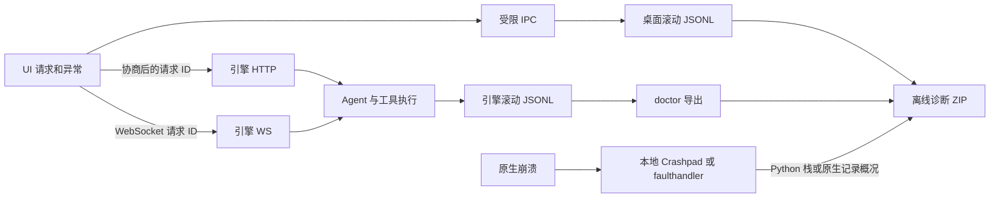

# MIRA 运行日志与故障诊断

设计与实现日期：2026-10-12。适用于配对的 mira 引擎与 mira-ui 桌面应用。

目标是从一次白屏、连接失败或进程退出，定位到实际运行版本、发生故障的进程、请求、agent 执行和代码位置。日志默认保存在本地，采集与导出不依赖云端监控服务，不自动上传。

## 现状与本轮改进

| 层 | 原有能力与缺口 | 本轮实现 |
| --- | --- | --- |
| 引擎运行 | 大量 Loguru 调用，缺少统一的持久化运行日志入口 | gateway 与 API 启动时安装运行日志、标准 logging 桥接和异常捕获 |
| 本地服务管理 | agent-service.log 有生命周期 JSON，却混入重定向的 stdout/stderr | 生命周期补充 schema、组件、PID 与请求 ID；导出只读取其中的结构化元数据 |
| Python 异常 | 异常可能只留在 stderr | 未捕获主线程、线程和 asyncio 错误记录类型与栈位置；faulthandler 捕获原生致命信号的 Python 栈 |
| Electron 主进程 | 引擎管理操作未持久化，缺少启动与崩溃日志 | 启动、上次异常退出、引擎阶段、命令结果/超时、子进程异常、未捕获异常持久化 |
| Renderer | React ErrorBoundary 主要输出 console | React、全局 error、unhandledrejection、WebSocket 连接和发送、HTTP 失败记录 |
| 原生 Renderer | 没有主进程侧终止/卡死记录 | render-process-gone、unresponsive、responsive、did-fail-load |
| Native crash | 没有应用级本地采集入口 | Crashpad 本地采集，uploadToServer=false；普通导出不含 minidump |
| 诊断交付 | doctor 没有汇总桌面日志和运行日志 | 设置与 Help 菜单导出 ZIP；引擎不可用时仍导出桌面日志并声明缺项 |

入口：引擎 [observability.py](../mira_engine/observability.py)、[agent_service.py](../mira_engine/cli/agent_service.py)；mira-ui 的 `electron/diagnostics.ts`、`src/services/diagnostics.ts`。

## 日志链路



### 关联规则

- `boot_id`：每个进程启动生成的新 ID。引擎和桌面进程分别拥有，不假设服务跟随 UI 一起重启。
- `request_id`：UI HTTP 或 WebSocket 请求的 ID；WebSocket 入站传入 agent 的诊断 metadata，执行日志沿用它。
- `run_id`：每次 agent dispatch/direct 执行生成，用于区分并发任务。
- `connection_id`：引擎 WebSocket 连接 ID。
- `session_ref`：会话 key 的 HMAC-SHA256 摘要（截取 64 bit），避免记录用户标识或完整路径。密钥是每个安装随机生成的 `logs/runtime/ref.key`（权限 0600，不进入诊断包），因此诊断包接收方无法对手机号等低熵 key 做暴力还原；同一安装内同一会话的 ref 保持稳定。日志目录不可用时退化为进程级随机密钥，ref 仅在该进程内稳定。`instance_ref` 使用同一密钥。
- `/stop` 不经过 dispatch，单独记录 `agent.stop.requested/completed`，并沿用 WebSocket stop 请求的 `request_id`。
- `workflow_run_id`：存在且符合元数据规则时补充已有工作流 ID。
- 引擎管理命令通过 `MIRA_DIAGNOSTIC_REQUEST_ID` 将桌面命令 ID 传入 CLI 生命周期日志；常规非提权命令已覆盖，Windows 提权链路不承诺自动继承该环境变量。未继承时，同一 CLI 进程写出的所有生命周期事件共用一个进程级 `request_id`。

HTTP 追踪头为 `X-Mira-Request-Id`。UI 先读取 `/api/version`：只有 `diagnostics_contract=1` 时才追加此头，避免旧版远程引擎的 CORS 预检失败。服务器允许并暴露此响应头。查询字符串、请求体、响应正文和认证头均不进入诊断记录。

## 数据结构与事件

新运行日志的共同字段为 `schema_version=1`、UTC `timestamp`、`component`、`pid`、`boot_id`、`version`、`level`、`event`。引擎的事件元数据位于记录顶层，桌面与 renderer 的元数据位于 `fields`；既有 service JSON 保留兼容格式，新增 schema、组件、PID 和请求 ID，不具备完整运行日志字段。收集器按这三个已知格式读取，不把任意业务 JSON 识别成日志。

异常保留类型与源文件位置，省略异常消息、源代码文本与局部变量。Python 的异常记录位于 `exception`，桌面记录位于 `error`。桌面记录额外包含 Electron/Chromium 版本；诊断包中的 doctor 状态保留引擎 executable/manifest identity。

| 场景 | 事件 |
| --- | --- |
| 进程生命周期 | process.started、gateway.starting、gateway.failed、gateway.stopped |
| Python 全局异常 | process.uncaught_exception、thread.uncaught_exception、asyncio.unhandled_exception |
| 旧日志桥接 | runtime.log、runtime.standard_log，仅保留级别、位置和异常栈。asyncio 默认处理器转写的同一异常不重复记录为 runtime.standard_log |
| 请求 | http.completed、http.failed；UI 为 http.response_error、http.network_error |
| WebSocket | websocket.connected、received/sent、disconnected/closed、failed |
| Agent | agent.dispatch.started/finished/failed/cancelled、agent.turn.failed、agent.direct.* |
| 工具与模型 | tool.started/finished/failed/cancelled、provider.failed；/stop 或关闭导致的取消记为 INFO 级 tool.cancelled，不计入 ERROR |
| 停止请求 | agent.stop.requested、agent.stop.completed（count 为取消的任务数） |
| 桌面状态 | app.started、app.previous_unclean_exit、app.quit_requested、engine.phase_changed |
| 引擎管理命令 | engine.command_started/finished/timeout、engine.elevated_command_started/finished |
| UI 崩溃与卡死 | renderer.react_error、uncaught_error、unhandled_rejection、process_gone、unresponsive、load_failed |

`finished` 表示执行范围结束，不能单独理解成业务成功；应结合 failed、cancelled 和实际任务结果判断。日志不是会话历史，也不替代安全审批审计。

## 存储与故障降级

- 引擎日志：`<当前 config.json 所在目录>/logs/runtime/engine-<pid>-<boot_id>.jsonl`。
- Python 原生栈：同目录的 `fault-<pid>-<boot_id>.log`。
- 桌面与 renderer 日志：`app.getPath('userData')/diagnostics/desktop-<pid>-<boot_id>.jsonl`。
- 原生 dump：`app.getPath('crashDumps')`，具体目录布局由 Electron 管理。
- 日志文件以 2 MiB 滚动，保留 3 个备份。新一轮启动清理较早的自有日志文件，目标为 32 个；引擎不清理仍有存活 PID 的日志，因此大量并发进程可超过该数量。
- 原生 dump 启动时执行有界扫描，尽力保留 30 天以内、最新 10 个且合计不超过 64 MiB 的 `.dmp`。不处理其他文件或符号链接。
- ERROR/CRITICAL 同步刷新，避免关键事件滞留在异步队列。一般事件也采用有界、同步追加。
- 日志目录不可写或磁盘出错不应阻止应用工作；记录 write-error 数量。完全无法打开日志目录时只给固定 stderr 提示，不输出私有内容。
- 诊断处理器挂到 root logger 会关闭 Python 的 `logging.lastResort`。若启动时 root 尚无其他 handler，引擎同时挂一个 WARNING 级 stderr handler，第三方库（asyncio、aiohttp 等）的 WARNING/ERROR 仍像以前一样输出到 stderr 与 `agent-service.log`。
- Renderer IPC 只接受当前主窗口顶层 frame，字段经 allowlist 过滤，每秒限 60 条。日志环形缓存最多 300 条。
- 桌面引擎命令 stdout/stderr 仅在内存中保留最后 256 KiB，日志不复制其正文。

新引擎 JSONL 与桌面日志已受滚动限制。历史 `agent-service.log` 仍承接 OS 服务的原始 stdout/stderr，不承诺和新 JSONL 相同的持续写入/轮转语义；诊断导出不会把这些原始行带出。后续若迁移该文件，必须同时调整 launchd、systemd、Windows wrapper 的重定向与现有运行服务，不能对仍打开的文件盲目 rename。

## 导出和定位问题

桌面正常时：设置 → 故障诊断 → 导出诊断文件。白屏或 renderer 已终止时：Help 菜单 → Export diagnostics / 导出诊断文件。React 错误页也有导出入口。

引擎所在机器：

```bash
mira-engine doctor --export
```

返回 JSON 的 `diagnostics_bundle` 给出 ZIP 路径。doctor 健康检查失败时仍可能已生成诊断包，应读取结果中的路径，而不是只看进程返回码。非默认 config 的运行日志根据 service state 中的 config_path 收集；未注册到 service state 的独立自定义实例，需另外取得其日志目录。

桌面 ZIP 包含桌面日志 tail、manifest，以及成功收集时的嵌套 `engine-diagnostics.zip`。引擎包包含 doctor、service state、结构化生命周期 tail 和运行日志 tail。每个日志文件最多读 128 KiB，最多选 16 个，读取失败（包括导出期间被轮转或清理的文件）在 manifest 记录；不为导出启动或修复引擎服务。诊断包创建时即为 0600，导出失败时删除半成品。

结构化生命周期 tail 只接受 service 管理器自己写出的行：`component=engine-service`、`schema_version=1`，`event` 为小写事件名，`timestamp` 为 ISO 8601。MCP server 或脚本的 stderr 即使是带 `event` 字段的 JSON（如 structlog 默认输出）也会被丢弃；无法解析或嵌套过深的行同样跳过。

远程模式不收集本机未使用的引擎。浏览器版导出当前标签页的诊断缓存，无法保留标签页崩溃前已丢失的内存；远程引擎日志需在服务器端导出。

排查顺序：

1. 检查 manifest 的版本、PID、boot_id、缺项及 write_errors。
2. 搜索 ERROR/CRITICAL，区分 renderer JS、renderer 原生终止、主进程、引擎或网络故障。
3. 按 request_id 查找跨组件记录，再按 run_id 跟踪 agent/tool 执行。
4. 检查故障前的引擎 phase、命令超时、WS 断开及未捕获错误。
5. 根据栈位置与对应版本的 source map 定位源代码；桌面构建生成 hidden source maps，应保留对应版本产物。
6. 修复后建立能触发原故障的回归测试，并再次确认诊断证据。

## 隐私与验证边界

默认诊断记录不包含对话正文、工具参数、工具输出、完整 URL、配置文件内容、异常局部变量或原生 minidump。对旧字符串日志不能依靠正则保证临床文本脱敏，因此持久化桥接只保留位置；导出原始 service 输出则直接省略非结构化行。

旧控制台输出仍可能包含业务文本；它与新诊断 JSONL 不是同一个隐私契约。自定义配置目录、源文件名及用户自行写入的日志也可能带标识，应在人工分享前审阅诊断包。Crashpad dump 可含进程内存，仅留在本地，普通导出明确排除。

已验证 Python 未捕获异常与独立子进程 SIGABRT 的记录、日志轮转、并发上下文隔离、磁盘失败降级、诊断包过滤，以及实际 Electron renderer 终止后记录和离线导出。隔离 Electron 36.9.5 演练观测到 `reason=killed`、exit code 2，且本地生成 1 个 `.dmp`，uploadToServer=false；这不代表所有平台或所有原生崩溃类别都已演练。

SIGKILL、断电和机器整体冻结无法在被终止进程中运行 Python/JS 回调。此时依赖此前已写入日志、桌面下次启动的未正常退出标记，以及 OS/服务管理器信息。新实现尚未部署到当前正在运行的用户服务，不将源码测试或独立演练当作已安装版本的验证。

## 后续建设

在实际故障样本积累后，再评估统一全字段 JSON schema、跨版本日志查询器、挂起 watchdog、release SHA 与 source-map 索引、CLI/独立 SDK 实例初始化，以及经用户主动授权的诊断上传。优先保留稳定事件名、字段 allowlist 和故障测试，避免把日志演变为高成本的完整请求录制。

官方依据：[Electron Crashpad](https://www.electronjs.org/docs/latest/api/crash-reporter)、[webContents 事件](https://www.electronjs.org/docs/latest/api/web-contents)、[Python faulthandler](https://docs.python.org/3/library/faulthandler.html)。

本次验证结果与隔离原生演练证据见 [QA 记录](qa/runtime-diagnostics-2026-10-12/report.md)。
