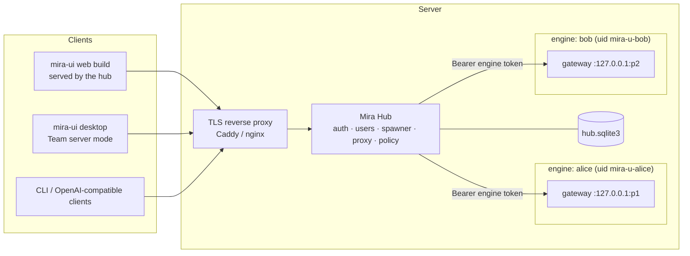
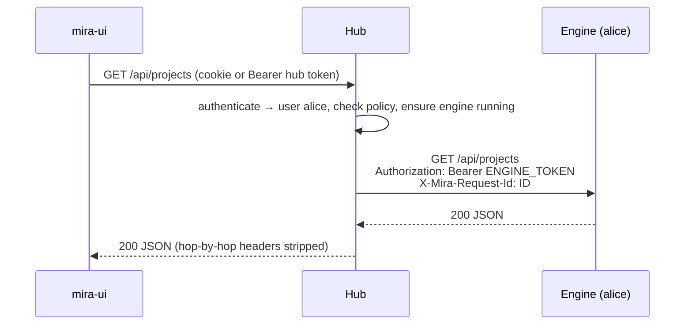
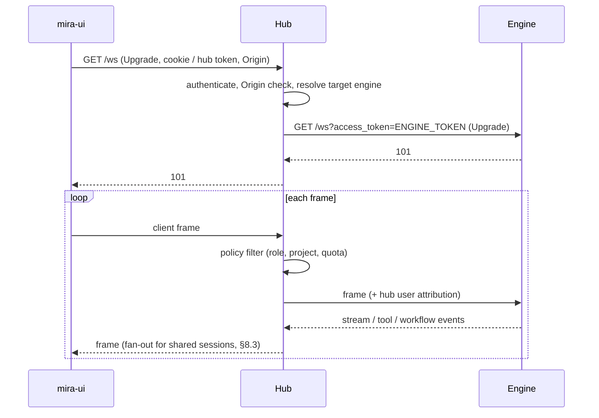
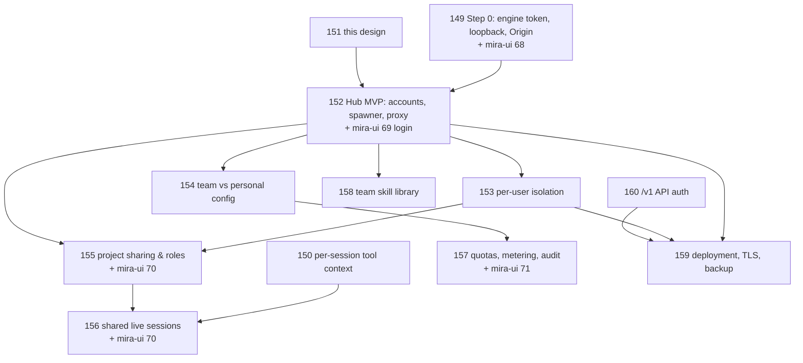

# Mira Server Edition: Hub Architecture

Status: Draft for review (#151). Milestone: *Server Edition (Multi-user)*.

This document describes how a team runs Mira on a shared server. Every user has
their own identity and permissions, and users can share projects and live sessions.
The design follows **Plan B**: an authenticating **Mira Hub** in front of **one
isolated `mira-engine` per user**, similar in shape to JupyterHub. The engine stays
a single-user program; multi-user concerns live in the hub.

## 1. Goals and non-goals

### Goals

- A team installs Mira once on a Linux server and each member signs in with
  their own account.
- Strong isolation: one user's agent (shell, filesystem, MCP, keys) cannot read
  or modify another user's data, even if the agent is prompt-injected.
- Admins control team provider keys, models, sandbox policy and quotas.
  Members may bring personal keys.
- Projects can be shared with roles, and a live session can be joined by several
  people while model usage is billed to the session owner.
- The desktop app keeps working unchanged in local mode. Hub features are opt-in.
- Reuse the existing engine with minimal change.

### Non-goals (for this milestone)

- Making one engine process multi-tenant.
- Public SaaS: billing, sign-up and abuse handling for anonymous users. The hub
  targets teams of roughly 5–100 people on infrastructure they control.
- Horizontal scaling of one user's engine across machines, and HA hub clusters.
  A single hub node is enough; see §12 for the path beyond.
- Real-time co-editing of deliverables (CRDT). Sharing is project and session
  based. Co-editing is a later milestone.
- Several engines writing to one project directory. This stays out of scope, as
  in `docs/modular-workflow-api-contract.md`. A project always has exactly one
  hosting engine.

## 2. Why one engine per user (Plan B)

Today the engine assumes one user everywhere:

| Area | Current behaviour (code) |
|---|---|
| Identity | No user model. WebSocket `user_id` is client-supplied and defaults to `ui_user` (`channels/ui.py` WS handler); used only for logging and the workflow `lease_owner`. |
| State | `MIRA_HOME` (`config/loader.py:get_home_dir`) holds one `config.json`, `media/`, `cron/`, `logs/` and the UI registries `workspace.json` / `organization.json`; `ProjectRegistry` has a single `projects_root` (`projects.py`). |
| Keys | `ProviderConfig.api_key` lives once per provider in the global `config.json`; `POST /api/config` rewrites it and hot-swaps provider and model for every session. |
| Tools | Run as the engine's OS user. `tools.restrict_to_workspace` defaults to `false`, `tools.exec.sandbox` defaults to `""` (`config/schema.py`). Per-turn context is set on shared tool instances (#150). |
| Background services | Cron, heartbeat, MCP servers and IM channels are started once per gateway process (`cli/commands.py:gateway`). |

Making the process multi-tenant would mean touching every row, and any one we
miss becomes a cross-user leak. With one engine per user, the OS (or a
container) is the isolation boundary, and the engine's existing single-user
semantics stay correct.

Cost: one Python process per *active* user, roughly 150–400 MB RSS plus MCP
children. Idle culling (§9) keeps this bounded. For the target team size this is
acceptable.

## 3. Components



### 3.1 Mira Hub (`mira_hub/`, new package in this repo)

- **Auth**: local accounts first, OIDC, LDAP and Feishu later (§5).
- **User store**: SQLite, holding users, roles, sessions, project memberships,
  engine records, quotas and the audit log.
- **Spawner**: starts, stops and health-checks one engine per user, assigning
  the port, `MIRA_HOME` and engine token (§6).
- **Proxy**: authenticates every request and forwards `/api/*` and `/ws` to the
  right engine, injecting that engine's token. Browsers never see engine tokens.
- **Policy**: route-level authorization for roles, admin-only routes and shared
  project access (§8), plus quota checks (§10).
- **Static UI**: serves the mira-ui web build on the same origin, so hub session
  cookies work without CORS.

**Stack: Python + aiohttp**, shipped as a second package in this repo with a
`mira-hub` console script. Reasons:

- The engine gateway is already aiohttp (`channels/ui.py`). Proxying WebSocket
  and streaming HTTP in aiohttp is straightforward, and the team already
  maintains this stack.
- The hub can import shared pieces (`config/schema.py` models,
  `observability.py`, the `TokenUsageStore` reader) instead of re-implementing them.
- One CI pipeline and one release train. A separate `mira-hub` wheel, or an
  extra (`mira-engine[hub]`), keeps hub dependencies such as `argon2-cffi` and
  `authlib` out of desktop bundles.

Not chosen: Go or Node for the hub (a second toolchain for a small service), and
JupyterHub itself (its spawner and proxy model fits, but its auth, UI and
Jupyter-specific APIs would need heavy adaptation).

### 3.2 Per-user engine

This is the existing `mira gateway`, unchanged in behaviour, started by the hub
with:

- `MIRA_HOME=/srv/mira/users/<uid>/home`
- `--host 127.0.0.1 --port <assigned>`
- Engine token from Step 0 (#149): `MIRA_GATEWAY_TOKEN=<random>`, or
  `<MIRA_HOME>/runtime/gateway-token`.
- A hub-generated `config.json` layer (§7) with server-mode enforcement:
  - `tools.restrict_to_workspace=true`
  - `tools.exec.sandbox="bwrap"`
  - `gateway.project_storage="managed"`
  - `cors_origins` limited to the hub origin

### 3.3 mira-ui "Team server" mode (mira-ui#69)

This is a third deployment mode next to `localBundle` and `remoteManual`
(`src/stores/settingsStore.ts`). The user enters the server URL and signs in;
all traffic then goes to the hub. The web build served by the hub uses this
mode implicitly.

## 4. Request flow

### 4.1 HTTP



- The hub strips client `Authorization` and `Cookie` headers before forwarding
  and adds the engine token.
- It also adds:
  - `X-Mira-Hub-User: <user id>`
  - `X-Mira-Hub-Role: <role>`
  - a hub-generated `X-Mira-Request-Id`, which lines up with the engine's
    runtime diagnostics correlation (`observability.py`)

  Engines treat the `X-Mira-Hub-*` headers as **informational** (for logging and
  attribution); the hub already enforced policy before forwarding.
- Streaming responses and uploads (`/api/projects/{id}/files`) are proxied
  chunk-by-chunk, without buffering.
- Resource URLs that the UI loads through `` or `<iframe>` (artifacts,
  media) work through the cookie on the hub origin. The engine-side
  `access_token` query parameter is only used hub → engine.

### 4.2 WebSocket and streaming



- The hub parses client-to-engine frames: it reads `type` and `session_id`.
  This lets it enforce roles per project and reject frames from viewers. It
  then overwrites `user_id` with the authenticated hub identity, because today
  the engine trusts the client value (`ui.py` `data.get("user_id", "ui_user")`).
- Engine-to-client frames pass through unparsed, except for fan-out routing.
- When the client closes, the hub closes the upstream socket; when the engine
  restarts, the hub closes the client socket with code 1012, and mira-ui's
  existing reconnect logic (`src/services/websocket.ts`) re-establishes it.

## 5. Identity and authentication

### 5.1 Accounts

- **Phase 1**: local accounts.
  - Passwords are hashed with argon2id.
  - The first admin is bootstrapped by CLI: `mira-hub admin create`.
  - Admins create and disable users and reset passwords. There is no
    self-sign-up by default; an optional invite link can be added.
- **Phase 2**: an external IdP through a pluggable `Authenticator` interface:
  - OIDC (Google, Azure AD, Keycloak, Authing)
  - LDAP
  - Feishu OAuth, which is relevant because the Feishu channel already exists

  Users are matched or created by `(provider, subject)`, and the admin role can
  be mapped from IdP groups.

### 5.2 Hub sessions

| Client | Mechanism | Why |
|---|---|---|
| Web build (served by the hub) | `HttpOnly; Secure; SameSite=Lax` session cookie + CSRF token header on state-changing requests | No token in JS, so XSS cannot exfiltrate it; same origin, so no CORS. |
| Desktop (Electron) | Bearer access token (15 min) + refresh token (30 days) stored with Electron `safeStorage` | Cross-origin from `file://`; cookies are awkward there. Refresh tokens are revocable server-side. |
| CLI and `/v1` clients | Personal access tokens (PATs), scoped and revocable | Scripting and OpenAI-compatible tools (#160). |

**Recommendation:** use cookies for the web build and bearer plus refresh
tokens for desktop and CLI. Store every token as a SHA-256 hash in
`hub.sqlite3`, and have logout and disable revoke them immediately.

### 5.3 Hub ↔ engine

The hub uses exactly the Step 0 engine contract (#149):

- A per-engine random token passed as `MIRA_GATEWAY_TOKEN` (the hub owns it and
  rotates it on every spawn).
- `Authorization: Bearer` for HTTP, and `access_token` for the WebSocket upgrade.
- The engine binds `127.0.0.1`, and its Origin allowlist contains only the hub
  origin.

Because the engine only listens on loopback and needs a token, another user's
process on the same host cannot reach it either. A user's shell inside bwrap
shares the host network namespace unless network isolation is enabled (§7.3),
so the token is what matters there.

## 6. Spawner

### 6.1 Options

| | A. OS user + systemd (recommended for v1) | B. Container per user |
|---|---|---|
| Isolation | Separate Unix uid, `0700` home, systemd hardening (`ProtectSystem=strict`, `PrivateTmp`, `NoNewPrivileges`, `ReadWritePaths=` the user's home only), plus the bwrap sandbox for tools | Namespaces + cgroups, image-level reproducibility |
| Resource limits | systemd `MemoryMax`, `CPUQuota`, `TasksMax` | Docker / k8s limits |
| Ops complexity | Low: a single host, no container runtime. The hub needs a small privileged helper to create users and units. | Higher: Docker socket access, which is root-equivalent, or k8s. The image has to carry Python, bwrap, MCP runtimes and Node for the WhatsApp bridge. |
| Tools inside | The user's environment can install pip/conda per project (milestone "Per-project Python environments") | Every tool needs to be in the image or installed per container. |
| Sandbox | bwrap works natively (`agent/tools/sandbox.py`) | Nested bwrap needs `SYS_ADMIN` and unconfined seccomp; today's `deploy/docker-compose.yml` already has to relax both. |

**Recommendation: A (OS user + systemd) for v1.**

- It reuses the engine's existing Linux service knowledge (`cli/agent_service.py`
  already writes systemd units).
- It keeps the bwrap sandbox effective without weakening seccomp.
- It is the simplest thing operators can audit.

Keep the spawner behind an interface (`Spawner.start/stop/status`) so that a
`DockerSpawner` or `K8sSpawner` can follow for teams that require containers.

### 6.2 Spawner A details

- The hub runs as an unprivileged `mira-hub` user.
- A minimal helper, `mira-hub-helper`, does the privileged work. It is invoked
  via sudo with a fixed command allowlist, or as a root-owned socket-activated
  service. Its only operations are:
  - create or disable the Unix user `mira-u-<id>`
  - write the systemd unit from a fixed template
  - `systemctl start|stop|status mira-engine@<id>`
- The template unit `mira-engine@.service` runs
  `mira gateway --host 127.0.0.1 --port %port` as `User=mira-u-%i`.
- Ports are allocated by the hub from a configured range and recorded in the DB.
- Readiness: the hub polls `GET /health` and `GET /version` (both open, per
  #149), then a compatibility check against the engine's `/version`.

## 7. Data layout, isolation and configuration

### 7.1 Layout under `/srv/mira`

```text
/srv/mira/
  hub/                       # owner mira-hub, 0700
    hub.sqlite3              # users, sessions, memberships, engines, quotas, audit
    hub.toml                 # hub settings (listen, IdP, spawner, port range)
    secrets/                 # hub secret key, KEK for personal keys (§7.4)
    team-config.json         # admin-managed engine layer (§7.2)
    skills/                  # team skill library (§11)
  users/<uid>/               # owner mira-u-<uid>, 0700
    home/                    # MIRA_HOME for this user's engine
      config.json            # generated: team layer + user layer
      runtime/gateway-token  # engine token (0600)
      logs/ media/ cron/ ui/
      workspace/             # Quick Chat workspace
    projects/                # projects_root (managed storage)
      <project>/.mira/       # sessions/*.jsonl, memory, skills, token-usage.sqlite3
  shared/                    # reserved: future cross-user artifact exports
```

Server mode sets `gateway.project_storage="managed"`, so users cannot point
projects at arbitrary host paths (`/api/data-path/validate` becomes read-only).

### 7.2 Configuration layering (#154)

The effective engine `config.json` is merged by the hub on every spawn and
config change, in this order (later wins only where allowed):

1. **Server defaults**, built into the hub:
   - sandbox and `restrict_to_workspace` forced on
   - bind to loopback
   - `cors_origins=[hub origin]`
   - IM channels disabled unless the admin enables them
2. **Team layer** (`team-config.json`, admin):
   - team provider keys and `api_base`
   - model allowlist and defaults
   - MCP servers the team offers
   - capability switches per role (`shell`, `mcp_install`, `skill_install`, `web`)
3. **User layer**, stored in the hub DB:
   - preferences such as default model within the allowlist, and agent defaults
   - optional personal provider keys

In server mode the engine's config-mutating routes (`POST /api/config`,
`POST /api/providers/{name}/test`) go through the hub:

- Updates the user is allowed to make are written to the user layer.
- Team-layer fields are rejected with 403 unless the caller is an admin, and
  then they go through the admin API.
- `GET /api/config` returns masked values, as today.

### 7.3 Isolation and sandbox policy (#153)

- Each engine is a separate Unix user with a `0700` home and its own systemd
  hardening.
- Tool execution is forced through bwrap (`tools.exec.sandbox="bwrap"`):
  - only the project directory is mounted read-write
  - the config directory is masked behind tmpfs
  - the media directory is mounted read-only

  This matches `agent/tools/sandbox.py`. The admin can tighten it further:
  - `--unshare-net` per role (no network)
  - an egress allowlist through a proxy (later)
- `restrict_to_workspace=true` guards the file tools (`agent/tools/filesystem.py`).
  The shell regex guard (`agent/tools/shell.py`) stays as a second layer, but
  isolation does not rely on it.
- MCP servers spawned by an engine run as that user. Team MCP servers that
  need shared credentials should run as hub-managed network services rather
  than stdio children, so the credentials never reach user engines.
- **#150 must ship before any shared deployment**: per-turn tool context set on
  shared tool instances could make one session's tool run in another session's
  project. Across users OS isolation still holds, but shared sessions (§8.3)
  put several people's turns into one engine.

### 7.4 Key handling

- **Team keys** live in `team-config.json`, readable only by the hub. They are
  written into each user's generated `config.json`, which is `0600` and owned
  by that user, so a user's engine and sandboxed shell can technically read the
  team key. Because the sandbox masks the config directory, a prompt-injected
  shell cannot simply `cat` it, but a malicious *user* with direct shell access
  on the host could.
  - **v1:** accept this trade-off (documented). Team keys should be scoped
    per-team or per-project keys with provider-side spend limits.
  - **Later:** a hub-side LLM proxy, where the engine's provider `api_base`
    points at the hub, which injects keys and meters usage. This also enforces
    quotas at the source (§10). It is listed as an open question.
- **Personal keys** are encrypted at rest in the hub DB, using AES-GCM with a
  KEK stored in `hub/secrets/`. They are decrypted only when the user's engine
  config is generated and never returned to clients.

## 8. Sharing (#155, #156)

### 8.1 Model

- A project belongs to exactly one **owner** and is hosted in the owner's engine.
- **Members** have one of three roles:

| Role | Read history and artifacts | Send messages | Run tools / workflows | Manage members, settings |
|---|---|---|---|---|
| viewer | ✓ | ✗ | ✗ | ✗ |
| editor | ✓ | ✓ (direct, or via approval if the owner enables it) | ✓ (or via approval) | ✗ |
| owner | ✓ | ✓ | ✓ | ✓ |

- Membership lives in the hub DB (`project_members(project_id, owner_uid,
  member_uid, role)`).
- When a member opens a shared project, the hub routes their requests to the
  **owner's** engine, using a route allowlist per role. For example, viewers
  get only `GET` history and artifacts, and `ws` frames limited to subscribe
  types.
- Members never get filesystem access to the owner's directories. Everything
  goes through the owner's engine API, under the owner's sandbox.

### 8.2 Billing

All model usage in a shared project is charged to the **owner** (their keys and
quota), because the work runs in the owner's engine. The token-usage records
(`.mira/token-usage.sqlite3`) gain the acting hub user id, taken from the
attribution header, so the owner can see who consumed what.

### 8.3 Shared live sessions

Today the engine's UI channel keeps **one** WebSocket per session:
`self._clients: dict[str, WebSocketResponse]`, where each new connection
overwrites `_clients[session_id] = ws` and `send()` delivers only to that one
socket. Two ways to fix it:

- **Option 1 (recommended)**: the engine keeps `dict[str, set[WebSocketResponse]]`,
  and `send()` and the stream, tool and workflow emitters broadcast to every
  socket. The hub opens one upstream socket per member connection and only does
  policy. This is a contained engine change (#156), keeps the engine usable on
  its own, and also fixes "two windows on one session" for desktop users.
- **Option 2**: the hub multiplexes, keeping one upstream socket per session
  and fanning out to clients. That puts more protocol knowledge in the hub
  (subscriptions, workflow replay cursors) and was rejected.

On top of fan-out:

- **Presence**: the hub tracks connected members per session and pushes a
  `presence` event.
- **Attribution**: user messages carry the hub user id and display name, and
  are persisted in the session JSONL metadata.
- **Approval queue** (optional per project): editor messages and tool calls go
  into a pending queue that the owner approves. This reuses the existing
  confirmation patterns, such as module-execution confirmation and per-run
  manual checkpoints.
- **Turn arbitration**: the engine already serialises a session's turns. A
  second sender while a turn is running gets "queued" feedback rather than an
  interleaved turn.

## 9. Lifecycle and failure modes

| Event | Behaviour |
|---|---|
| First request of a user | Hub spawns the engine (cold start ~2–5 s); UI shows "starting your workspace". |
| Idle culling | No HTTP or WS activity and no running workflow or cron job for `idle_timeout` (default 2 h) → hub stops the engine. Cron and heartbeat jobs pin the engine as active, or (open question) the hub wakes engines on schedule. |
| Engine crash | The systemd unit restarts it; the hub sees `/health` fail, closes client WS with 1012, and the clients reconnect. Running workflows resume from their durable run state (workflow storage contract). |
| Hub restart | Engines keep running. The hub reloads its engine table from the DB, re-validates each engine with `/health`, and clients reconnect. Engine tokens persist in the DB, so no restart is needed. |
| Engine upgrade | The hub upgrades the package once. Engines pick it up on their next restart; the admin can roll out by restarting idle engines first. The hub refuses to route to engines whose `/version` is incompatible. |
| Disk or memory pressure | systemd limits are enforced per engine; hub admin view shows per-user usage. |
| User disabled | Hub revokes sessions and tokens, stops the engine, and keeps the data until an admin deletes it. |

## 10. Quotas, metering and audit (#157)

- **Metering source**: the engine's token-usage store already attributes usage
  per session, run and model. The hub periodically reads per-user totals and
  aggregates them into `usage_daily(user, project, model, tokens…)`. Reading is
  done via a new engine endpoint or by reading the SQLite files directly; the
  hub has read access to users' homes through the helper.
- **Quotas**: tokens per day/month per user, soft (warn) and hard (block new
  turns at the hub's WS policy layer). Hard limits are enforced on the next turn
  rather than mid-stream. A hub-side LLM proxy (§7.4) would make enforcement
  exact.
- **Audit log**, metadata only, following `docs/runtime-diagnostics.md` privacy
  rules: logins, token issue and revoke, config changes, shares and role
  changes, engine spawn and stop, and per-turn tool execution summaries
  (tool name, project, outcome; no arguments or content).

## 11. Team skill library (#158)

- The hub hosts `hub/skills/`, a versioned library with publish, install and
  fork. Installing a skill copies it into the user's project or workspace
  `.mira/skills/`, using the existing skill-plugin install routes.
- Skills declare required capabilities (`files`, `network`, `shell`, `mcp`).
  Install requires confirmation, and capabilities above the user's role
  switches are refused.
- Later, hub accounts are linked to mira-community accounts so skills can be
  published publicly (milestone "Mira Community Platform").

## 12. Deployment (#159) and the /v1 API (#160)

- **Reference deployment**:
  - a TLS reverse proxy (Caddy, with automatic certificates, or nginx)
  - `mira-hub` (systemd service)
  - `mira-engine@<user>` units

  Everything is installed from the release wheel, and a docker-compose variant
  covers the hub and proxy for evaluation.
- **Backup**: `hub/` and `users/*/` with filesystem snapshots. SQLite files are
  backed up with `.backup`, or while engines are stopped. **Restore**:
  restore the directories, recreate the Unix users from the hub DB with
  `mira-hub repair`.
- **Scaling beyond one host** (later): a `RemoteSpawner` that places engines on
  worker nodes, with the hub routing by `engine.host:port`. The engine contract
  (loopback bind) then becomes "bind to the private interface plus mTLS or
  token", which is why the token, not the bind address, is the primary control.
- **`/v1` (OpenAI-compatible) API**: `mira serve` gets bearer-key auth (#160).
  In server mode the hub exposes `/v1/*` itself, authenticates PATs, and
  proxies to the user's engine, so external tools use per-user tokens and
  per-user quotas.

## 13. Threat model

| Threat | Mitigation |
|---|---|
| Unauthenticated network access to an engine (today's default `0.0.0.0`, no auth) | #149: token on all routes, loopback bind, Origin allowlist; engines reachable only via the hub. |
| Malicious web page driving a local or remote engine (CSRF, cross-site WS) | Origin checks on engine and hub; `SameSite` cookie + CSRF header on the hub; bearer tokens never in cookies for desktop. |
| User A reads user B's files via the agent | Separate Unix users with `0700` homes, bwrap sandbox with only the project mounted, `restrict_to_workspace`, managed project storage. |
| Prompt injection exfiltrating secrets | Config directory masked in the sandbox, optional network isolation per role, team keys preferably behind a hub LLM proxy. |
| Member escalating within a shared project | Hub enforces a route and frame allowlist per role; hub overwrites client `user_id`; owner approval queue. |
| Stolen hub token | Short-lived access tokens, hashed storage, revocation on logout or disable, audit log. |
| Hub compromise | Hub runs unprivileged; privileged helper limited to a fixed command set; secrets confined to `hub/secrets/`. |
| Resource exhaustion by one user | systemd `MemoryMax`, `CPUQuota`, `TasksMax`; quotas; idle culling. |
| Cross-session tool context bleed inside one engine | #150 fix (per-call context); required before shared sessions. |

## 14. Open questions for the maintainer

1. **Spawner**: is OS user + systemd acceptable for v1 (recommended), or do
   target customers require containers or Kubernetes from day one?
2. **Team key exposure**: accept team keys in per-user engine configs for v1,
   or build the hub-side LLM proxy first? The proxy gives exact quotas and no
   key exposure, but it is a larger scope and sits on the latency path.
3. **IdP priority**: which external login comes first after local accounts:
   Feishu, OIDC (which provider), or LDAP?
4. **IM channels in server mode**: should Feishu, Slack and WhatsApp bots be
   per-user (each engine with its own bot), or a single team bot run by the hub
   that maps `sender_id` to hub users and routes to their engines?
5. **Scheduled work and culling**: should cron and heartbeat keep a user's
   engine alive permanently, or should the hub own scheduling and wake engines?
6. **Project ownership transfer and team-owned projects**: is a project always
   owned by one person, or do we need team-owned projects hosted in a service
   engine?
7. **Desktop app and hub**: should the desktop app's Team-server mode also be
   able to run some projects locally (hybrid), or is it a pure thin client to
   the hub?
8. **Packaging**: a separate `mira-hub` distribution, or an extra
   `mira-engine[hub]` in the same wheel?
9. **Licensing and edition**: is the server edition open source like the
   engine, or a separately licensed edition? This affects package placement.

## 15. Phased plan



| Phase | Tickets | Outcome |
|---|---|---|
| 0. Hardening | #149, mira-ui#68, #150, #160 | Engine safe to expose behind a proxy; no cross-session context bleed. |
| 1. Hub MVP | #151, #152, mira-ui#69, #153 | Several users on one server, each in an isolated engine. |
| 2. Team config | #154, #157, mira-ui#71 | Admin-managed keys, models and policies; quotas and audit. |
| 3. Collaboration | #155, #156, mira-ui#70 | Shared projects with roles; shared live sessions billed to the owner. |
| 4. Ecosystem and ops | #158, #159 | Team skill library; production deployment guide. |

Development happens on the long-lived `feat/server-edition` branch. Each ticket
gets its own branch and PR into it, and `dev` is merged into `feat/server-edition`
regularly. Phase 0 tickets that also fix desktop behaviour (#149, #150, #160,
mira-ui#68) target `dev` directly.
