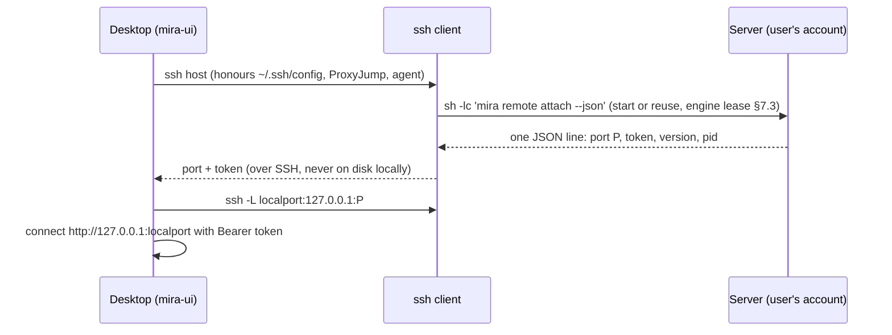
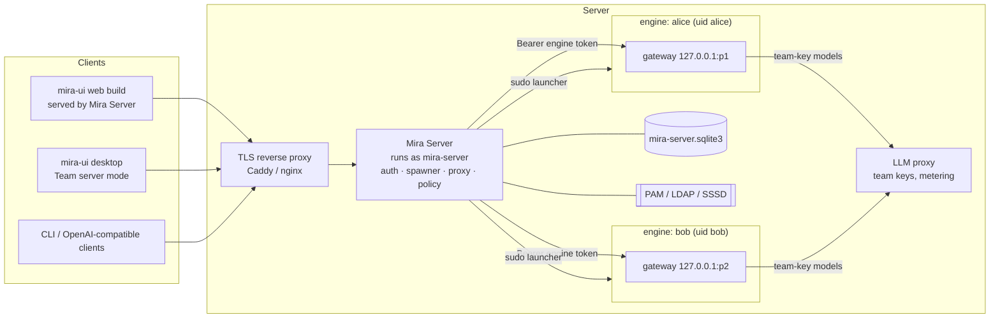
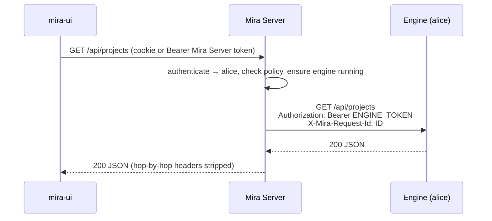
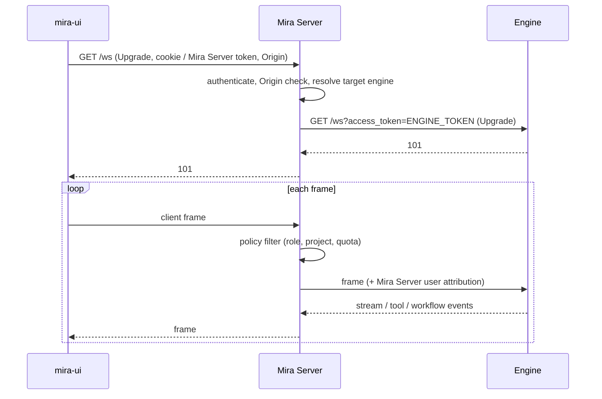
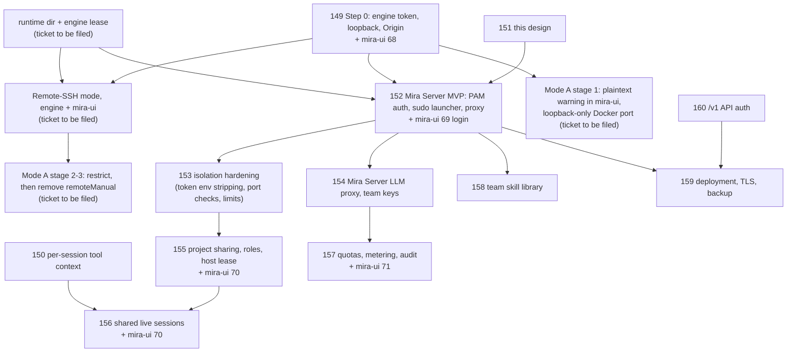

# Mira Server Edition: Architecture

Status: Draft for review (#151), revision 2. Milestone: *Server Edition (Multi-user)*.

This document describes how people use Mira on a shared server. The target
environment is a typical lab or company Linux host where every person already
has a server account (local or LDAP/SSSD) and a home directory.

The design follows **Plan B**: an authenticating **Mira Server** in front of
**one `mira-engine` per user, running as that user's own Unix account**. This
is the same shape as JupyterHub with PAM authentication and a sudo spawner.
The engine stays a single-user program; multi-user concerns live in Mira Server,
and the operating system's existing permissions are the isolation boundary.

Revision 2 changes: existing server accounts are the default identity source
(not OS users created by Mira), access modes are defined with a deprecation
path for direct remote engines (§2), team keys go through a Mira Server LLM
proxy, and runtime state is separated from home-directory data.

**Terminology.** *Mira Server* is a placeholder name for the multi-user
component (package `mira_server`, service account and CLI `mira-server`); it is
spelled consistently so it can be renamed with one search-and-replace. *Host*
means the Linux machine it runs on.

## 1. Goals and non-goals

### Goals

- Reuse the server's existing accounts, groups and home directories. A person
  signs in with their server username and password; Mira stores no passwords.
- An agent can access exactly what its user can access on the host, no more.
  Existing group-shared directories (for example `/data/lab`) just work.
- A single user can use a remote engine without any Mira Server, over SSH
  only (Remote-SSH, §2.2).
- Teams can share projects and live sessions, with model usage billed to the
  session owner, and can use team provider keys without exposing them.
- The desktop app keeps working unchanged in local mode. Mira Server features are opt-in.
- Reuse the existing engine with minimal change.

### Non-goals (for this milestone)

- Making one engine process multi-tenant.
- Public SaaS: billing, sign-up and abuse handling for anonymous users. Mira Server
  targets teams of roughly 5–100 people on infrastructure they control.
- Managing server accounts. Creating users, groups and home directories stays
  with the host's existing tooling (LDAP, `useradd`, configuration management).
- Horizontal scaling of one user's engine across machines, and HA Mira Server clusters.
- Real-time co-editing of deliverables (CRDT). Sharing is project and session
  based.
- Several engines writing to one project directory, as in
  `docs/modular-workflow-api-contract.md`. A project has exactly one hosting
  engine at a time (§7.3, §9.1).

## 2. Access modes

| | A. Direct remote engine (**deprecated**) | B. Remote-SSH | C. Mira Server |
|---|---|---|---|
| Who | One person | One person | A team |
| Host side | `mira gateway` started by hand (or as the user's service) | Nothing pre-started; the desktop starts it over SSH | `mira-server` service run by an admin |
| Authentication | Gateway token (#149) | SSH (keys, agent, `~/.ssh/config`, ProxyJump) | Host account via PAM / LDAP |
| Transport security | None unless added by the operator | SSH tunnel | TLS reverse proxy |
| Engine runs as | Whoever started it | The SSH user | The signed-in user (sudo launcher) |
| Needs root / admin | No | No | Yes, once (install Mira Server, sudoers rule) |
| Sharing, shared sessions, team keys, quotas | No | No | Yes |

The engine gateway's long-term clients are only: the local desktop, Remote-SSH
tunnels, and Mira Server. Direct remote access (Mode A) is phased out.

### 2.1 Mode A: direct remote engine (deprecated)

This is what works today: the engine is installed on a host and mira-ui's
`remoteManual` mode connects straight to its `http://` and `ws://` endpoints.

Why it is phased out:

- The gateway token and all traffic (prompts, files, results) are plaintext
  unless the operator adds TLS, and most setups don't.
- The engine must listen on a non-loopback address, so every machine that can
  reach the port can attempt to authenticate.
- Remote-SSH gives the same single-user experience with SSH's authentication
  and encryption and no open port; Mira Server covers teams.

**Deprecation path:**

| Stage | When | Engine | Desktop (mira-ui) |
|---|---|---|---|
| 1. Warn | Now, with #149 / mira-ui#68 | Token required; non-loopback bind logs a startup warning. | `remoteManual` warns when the URL is plaintext (`http`/`ws`) to a non-loopback host and suggests an SSH tunnel. |
| 2. Restrict | When Remote-SSH ships | Non-loopback bind requires an explicit opt-in (setting or `--allow-remote-bind`), meant only for containers behind a TLS proxy or Mira Server. | `remoteManual` accepts only loopback URLs (manual SSH tunnels) or `https`/`wss` URLs; existing plaintext profiles are offered a migration to Remote-SSH. |
| 3. Remove | After at least one release in stage 2 | Opt-in bind remains only for container deployments. | `remoteManual` is removed; connection modes are local, Remote-SSH and Team server. |

Until stage 3, the safe way to use Mode A is the manual tunnel:
`ssh -N -L 18790:127.0.0.1:18790 user@host`, then connect to
`http://127.0.0.1:18790` with the token from `mira gateway-token`.

**Affected: `docs/self-hosted-docker.md` and `deploy/docker-compose.yml`.**
The self-hosted stack publishes the engine on `0.0.0.0:18790` and has the web
UI container call it directly from the browser. In stage 1 the guide should
publish the engine port on the host's loopback only (`127.0.0.1:18790:18790`)
and document SSH-tunnel or TLS-proxy access. In stage 2 the engine container
sets the explicit bind opt-in. Longer term, the multi-user Docker deployment
becomes the Mira Server deployment (#159) and the browser talks only to Mira
Server.

### 2.2 Mode B: Remote-SSH (#166, MIRA-Intelligence/mira-ui#73)

The desktop app automates the SSH-tunnel setup, like VS Code Remote-SSH:



- Uses the system `ssh` binary, so existing keys, agents, jump hosts and
  2FA keep working. Mira stores no SSH credentials.
- The engine keeps running on the server when the laptop sleeps or the tunnel
  drops; the desktop reconnects and re-attaches.
- Engine-side contract: [`docs/remote-ssh.md`](../remote-ssh.md) (protocol 1,
  error codes, PATH discovery for non-interactive SSH).
- Engine version check on connect: if the server has no compatible engine, the
  desktop shows install or upgrade instructions (automatic install is a later
  option).
- Requires the single-engine lease (§7.3) so that a Remote-SSH engine, a
  Mira Server-spawned engine and a manually started `mira gateway` never write the
  same `~/.mira` at once.

Mode B is the recommended way for a single person to use a server: no admin
involvement, no new open ports, and the permission model is exactly SSH's.

### 2.3 Mode C: Mira Server

The rest of this document. Choose it when a team needs browser access,
project sharing, shared live sessions, team-owned provider keys, quotas or an
audit trail.

## 3. Why one engine per user (Plan B)

Today the engine assumes one user everywhere:

| Area | Current behaviour (code) |
|---|---|
| Identity | No user model. WebSocket `user_id` is client-supplied and defaults to `ui_user` (`channels/ui.py` WS handler); used only for logging and the workflow `lease_owner`. |
| State | `MIRA_HOME` (`config/loader.py:get_home_dir`) holds one `config.json`, `media/`, `cron/`, `logs/`, `runtime/` and the UI registries `workspace.json` / `organization.json`; `ProjectRegistry` has a single `projects_root` (`projects.py`). |
| Keys | `ProviderConfig.api_key` lives once per provider in the global `config.json`; `POST /api/config` rewrites it and hot-swaps provider and model for every session. |
| Tools | Run as the engine's OS user. `tools.restrict_to_workspace` defaults to `false`, `tools.exec.sandbox` defaults to `""` (`config/schema.py`). |
| Background services | Cron, heartbeat, MCP servers and IM channels are started once per gateway process (`cli/commands.py:gateway`). |

Making the process multi-tenant would mean touching every row, and any one we
miss becomes a cross-user leak. With one engine per user running as that
user's own uid, the kernel enforces the same file permissions the person
already has over SSH, and the engine's single-user semantics stay correct.

Cost: one Python process per *active* user, roughly 150–400 MB RSS plus MCP
children. Idle culling (§10) keeps this bounded.

## 4. Components



### 4.1 Mira Server (`mira_server/`, new package in this repo)

- **Auth**: PAM by default, direct LDAP bind as an alternative, Mira Server-managed
  accounts only as a fallback (§6).
- **User store**: SQLite with identities (username, uid, groups snapshot),
  Mira Server sessions, project memberships, engine records, quotas and the audit log.
  No passwords.
- **Spawner**: starts, stops and health-checks one engine per user through a
  sudo launcher (§7).
- **Proxy**: authenticates every request and forwards `/api/*` and `/ws` to the
  right engine, injecting that engine's token. Browsers never see engine tokens.
- **LLM proxy**: an OpenAI-compatible endpoint that holds team provider keys,
  enforces the model allowlist and quotas, and meters usage (§8.3).
- **Policy**: route-level authorization for roles, admin-only routes and shared
  project access (§9), plus quota checks (§11).
- **Static UI**: serves the mira-ui web build on the same origin, so Mira Server session
  cookies work without CORS.

**Stack: Python + aiohttp**, shipped as a second package in this repo with a
`mira-server` console script:

- The engine gateway is already aiohttp (`channels/ui.py`); proxying WebSocket
  and streaming HTTP in aiohttp is straightforward.
- Mira Server can import shared pieces (`config/schema.py` models,
  `observability.py`, the token-usage schema) instead of re-implementing them.
- One CI pipeline and one release train. A separate wheel or an extra keeps Mira Server
  dependencies (`python-pam`, `ldap3`, `authlib`) out of desktop bundles.

Not chosen: Go or Node for Mira Server (a second toolchain for a small service), and
JupyterHub itself (its spawner and proxy model fits, but its UI and
Jupyter-specific APIs would need heavy adaptation).

### 4.2 Per-user engine

The existing `mira gateway`, unchanged in behaviour, started as the user's
own uid by the launcher through `mira remote attach` (the Remote-SSH command,
§7.2), with:

- `MIRA_HOME=~/.mira` (the same home a local or Remote-SSH engine uses)
- the runtime dir on local disk (§8.1): `/run/user/<uid>` when it exists, else
  `~/.mira/runtime`
- `--host 127.0.0.1` and port 18790, or a random free port when that is taken
- the user's own gateway token (§6.3)
- Provider `api_base` for team models pointing at the Mira Server LLM proxy (§8.3, #154)

Mira Server forwards requests without an `Origin`, so the engine's own origin
allowlist needs no Mira Server entry.

Everything else comes from the user's own `~/.mira/config.json`. The user
owns that file, so nothing that protects *other* users is enforced through it
(§8.2).

### 4.3 mira-ui connection modes

| Mode | Status | Use |
|---|---|---|
| `localBundle` | exists | Engine on this machine |
| `remoteManual` | exists, **deprecated** (§2.1) | Mode A |
| `remoteSsh` | new (ticket to be filed) | Mode B |
| `teamServer` | new (mira-ui#69) | Mode C; server URL + sign-in, all traffic through Mira Server |

In Team-server mode the desktop is a **thin client**: all projects live on the
server. Hybrid local-plus-server projects are out of scope for v1.

## 5. Request flow

### 5.1 HTTP



- Mira Server strips client `Authorization` and `Cookie` headers before forwarding
  and adds the engine token, plus `X-Mira-Server-User`, `X-Mira-Server-Role` and a
  Mira Server-generated `X-Mira-Request-Id` (lines up with the engine's runtime
  diagnostics). Engines treat `X-Mira-Server-*` as informational; Mira Server already
  enforced policy.
- Streaming responses and uploads are proxied chunk-by-chunk.
- Resource URLs loaded through `` or `<iframe>` work through the cookie on
  the Mira Server origin. The engine-side `access_token` query parameter is only used
  Mira Server → engine.

### 5.2 WebSocket and streaming



- Mira Server reads `type` and `session_id` of client frames to enforce roles, and
  overwrites `user_id` with the authenticated identity (today the engine trusts
  the client value).
- Engine-to-client frames pass through unparsed.
- On engine restart Mira Server closes client sockets with code 1012; mira-ui's
  existing reconnect logic re-establishes them.

## 6. Identity and authentication

### 6.1 Identity sources

1. **PAM (default).** Mira Server authenticates username and password through the
   host's PAM stack (a dedicated `/etc/pam.d/mira-server` service), so local
   accounts, LDAP/SSSD, password policies, expiry and lockouts all apply as
   they do for SSH. Mira Server never stores passwords.
2. **Direct LDAP bind**, for deployments that cannot use the host PAM stack (for
   example a containerised Mira Server). Username → DN mapping and group lookup are
   configured in `mira-server.toml`.
3. **Mira Server-managed accounts (fallback)**, for hosts without per-person server
   accounts. Mira Server then creates a dedicated Unix user per Mira user through a
   privileged helper (the revision-1 design). Not part of the v1 MVP.
4. **OIDC / Feishu (later).** An external login must still resolve to a Unix
   account (for example a `preferred_username` or employee-ID claim mapped to
   the LDAP `uid`), because the engine runs as that account.

**Authorization uses groups**, resolved through NSS at login and refreshed
periodically: members of `mira-users` (name configurable) may use Mira Server,
members of `mira-admins` are Mira Server admins. Removing someone from the group, or
disabling the LDAP account, revokes access at the next check and stops their
engine.

### 6.2 Mira Server sessions

| Client | Mechanism | Why |
|---|---|---|
| Web build (served by Mira Server) | `HttpOnly; Secure; SameSite=Lax` session cookie + CSRF header on state-changing requests | No token in JS; same origin, no CORS. |
| Desktop (Electron) | Bearer access token (15 min) + refresh token (30 days) in Electron `safeStorage` | Cross-origin from `file://`; refresh tokens are revocable server-side. |
| CLI and `/v1` clients | Personal access tokens, scoped and revocable | Scripting and OpenAI-compatible tools (#160). |

Tokens are stored hashed; logout, group removal and account disable revoke them.

### 6.3 Mira Server ↔ engine

Mira Server uses the Step 0 engine contract (#149) through the Remote-SSH
contract (#171, #174). **Decision for the MVP (#152): reuse `mira remote
attach` instead of a Mira Server-generated token.**

- The launcher runs `mira remote attach --json` as the user. It starts or
  reuses the user's engine and prints one JSON line with `port` and the user's
  own gateway `token` (from `~/.mira/runtime/gateway-token`, `0600`, readable
  only by the user and root). Mira Server reads both from the launcher's stdout;
  nothing secret is passed in argv or the environment.
- Because Remote-SSH and Mira Server use the same command and the engine lease,
  a user has one engine whichever way it was started, and Mira Server can attach
  to an engine started over SSH.
- The engine binds `127.0.0.1`. Every local user can reach a loopback port, so
  the token is mandatory, and before the first proxied request to a port Mira
  Server verifies that every loopback listener on it belongs to the user's uid
  (§7.2, port squatting).
- The engine must strip `MIRA_GATEWAY_TOKEN` from the environment of tool
  subprocesses (shell, MCP stdio servers), so a prompt-injected command cannot
  call its own engine's API directly (engine work item).
- Later option: a Unix domain socket instead of TCP, removing the port-squatting
  class entirely.

## 7. Spawner

### 7.1 Options

| | Sudo launcher on the host (v1) | Container per user (later) | Batch scheduler, e.g. Slurm (later) |
|---|---|---|---|
| Runs as | The user's real uid | A container user mapped to the uid | The user's job |
| Files | Home and group-shared dirs as today | Bind-mounted home and data dirs | Cluster filesystems |
| Fit | Shared lab/company servers with existing accounts | Teams standardised on Docker/k8s | HPC clusters |

**v1: sudo launcher on the host.** It matches environments where people already
have accounts and homes, needs no container runtime, and keeps the engine's
bwrap sandbox effective. The spawner sits behind an interface
(`Spawner.start/stop/status`) so container and batch spawners can follow.

### 7.2 Sudo launcher details

- Mira Server runs as the unprivileged system user `mira-server`.
- One sudoers rule, nothing else:
  `mira-server ALL=(%mira-users) NOPASSWD: /usr/local/libexec/mira/engine-launch`
- `engine-launch` is a small root-owned script (the JupyterHub sudospawner
  pattern), written by `mira-server install-launcher`. It accepts only
  `start|status|stop` and reads no other input. It discards the caller's
  environment, sets `HOME`, `MIRA_HOME=~/.mira` and `PATH` from the passwd entry
  of the uid it runs as, and execs the system-installed engine:
  `/opt/mira/bin/python -I -m mira_engine remote attach|status|stop --json`
  (#152 decision: reuse the Remote-SSH commands). It never runs caller-supplied
  commands.
- **Resource limits**: when the user has a systemd user manager (lingering
  enabled by the admin), the launcher starts the engine with
  `systemd-run --user --unit mira-engine -p MemoryMax=… -p CPUQuota=…`;
  otherwise admins set limits for all of a user's processes with a
  `user-.slice.d/` drop-in. Either way limits are per user, not per Mira Server instance.
- **Ports**: `mira remote attach` binds 18790, or a random free loopback port
  when it is taken, so many users' engines coexist. **Port squatting**: before
  sending the token, Mira Server checks in `/proc/net/tcp{,6}` that every
  loopback listening socket on that port belongs to the expected uid; on
  mismatch it refuses the engine (state `error`) and logs a security event.
- **Readiness**: Mira Server checks `GET /health` and `GET /version` (open per
  #149) for a Mira gateway and the launcher JSON for remote protocol 1.
- Install and API details: [mira-server.md](mira-server.md).

### 7.3 Single engine per user

A person may have a Mira Server-spawned engine, a Remote-SSH engine and a manually
started `mira gateway`, all pointing at the same `~/.mira`, possibly on
different hosts sharing an NFS home. Only one may run at a time.

- **Engine lease** (#165, implemented): on start the engine takes a local
  OS lock (`engine.lock` in the runtime dir, released by the kernel when the
  process dies) and creates `~/.mira/engine.lease` with `O_EXCL` (safe on
  NFSv3+), containing hostname, pid, process start time, port, version and
  start time, and refreshes a heartbeat every 30 s. On the same host a record
  is live while its pid and start time match; from another host it is live
  while its heartbeat is newer than 3 intervals. Stale records may be taken
  over. The record also guards against a runtime dir wiped under a live
  engine (`/run/user/<uid>` removed at logout).
- A second start fails with exit code 3 and a clear message naming the
  holder (`engine already running for <home> (host X, pid Y, port P)`).
- Mira Server and Remote-SSH desktop show that message and offer to stop the other
  engine. Stopping is done by the launcher or over SSH as the same user, so no
  extra privilege is needed.

## 8. Data, configuration and keys

### 8.1 Layout

```text
/var/lib/mira-server/         # owner mira-server, 0700
  mira-server.sqlite3         # identities, sessions, memberships, engines, quotas, audit
  mira-server.toml            # listen, auth (PAM service / LDAP), spawner, port range
  secrets/                    # signing key, team provider keys (LLM proxy)
  skills/                     # team skill library (§12)

~alice/.mira/                 # MIRA_HOME, owned by alice (may be on NFS)
  config.json                 # alice's own config, 0600 (personal keys)
  engine.lease                # single-engine lease (§7.3)
  logs/ media/ cron/ ui/ workspace/ skills/

$MIRA_RUNTIME_DIR/<home-key>/ # local disk: MIRA_RUNTIME_DIR, else private $XDG_RUNTIME_DIR/mira,
  engine.lock, sockets, temp   # else ~/.mira/runtime; one subdir per MIRA_HOME (#165)

<any project dir alice can write>/   # e.g. ~/research/x or /data/lab/x
  .mira/                      # sessions/*.jsonl, memory, skills, token-usage.sqlite3
```

- Projects stay where users put them (`project_storage="user_selectable"`).
  Kernel permissions decide what each user can open, including group-shared
  lab directories.
- **NFS homes**: file locking and SQLite are unreliable on many NFS setups.
  The engine needs a `MIRA_RUNTIME_DIR` setting, separate from `MIRA_HOME`, for
  locks, sockets and transient state (engine work item). Per-project SQLite
  files (`token-usage.sqlite3`) on NFS must use a journal mode that is safe
  there, or move to the runtime dir with the project id as key; this is part
  of the same work item.

### 8.2 Configuration principle

The user owns `~/.mira/config.json` and can edit it outside Mira. Therefore:

- **Settings that protect the user** (sandbox, `restrict_to_workspace`) are
  defaults written for new users; a user who weakens them only affects
  themselves.
- **Settings that protect other users or the team** are never enforced through
  the user's config. They are enforced outside the engine:
  - loopback bind, token and allowed origins: launcher arguments and environment
  - file access: kernel permissions
  - team models, allowlist, spending: the Mira Server LLM proxy
  - shared-project access: Mira Server policy

In Team-server mode, config routes (`POST /api/config`, provider tests) still
write the user's own config; team settings live only in the Mira Server admin API.

### 8.3 Provider keys

- **Personal keys** stay in the user's `~/.mira/config.json` (`0600`), exactly
  as in local mode. Only the owner and root can read them.
- **Team keys never enter any home directory.** An engine runs tools as the
  user, so anything readable by the user's uid is readable by the agent and by
  the user. Team models are therefore served by the **Mira Server LLM proxy**:
  - the launcher configures an extra provider whose `api_base` is the Mira Server LLM
    proxy, authenticated with a per-engine proxy credential;
  - the proxy injects the real key, enforces the model allowlist and per-user
    quotas before the request, and records exact usage per user and project.
- The proxy is on the latency path; it streams responses without buffering.

## 9. Sharing (#155, #156)

### 9.1 File-level sharing: Unix groups

Teams already share data through group-owned directories. Mira does not
duplicate that: any user whose uid can read a directory can open it as a
project in their own engine. Because only one engine may host a project at a
time, each project gets a **project host lease** (`<project>/.mira/host.lease`,
same mechanism as §7.3). A second engine opening a hosted project gets it
read-only, or is redirected through Mira Server to the hosting engine.

### 9.2 Mira Server roles for live collaboration

- A shared project is hosted in its **owner's** engine.
- **Members** have one of three roles:

| Role | Read history and artifacts | Send messages | Run tools / workflows | Manage members, settings |
|---|---|---|---|---|
| viewer | ✓ | ✗ | ✗ | ✗ |
| editor | ✓ | ✓ (direct, or via approval if the owner enables it) | ✓ (or via approval) | ✗ |
| owner | ✓ | ✓ | ✓ | ✓ |

- Membership lives in the Mira Server DB. Requests from members are routed to the
  owner's engine with a route and frame allowlist per role. Work runs under the
  owner's uid, so members act with the owner's file permissions only through
  the operations their role allows, never through a shell of their own.

### 9.3 Billing

All model usage in a shared project is charged to the **owner** (their keys or
their team-key quota), because it runs in the owner's engine. Usage records
carry the acting Mira Server user from the attribution header.

### 9.4 Shared live sessions

Today the UI channel keeps **one** WebSocket per session
(`self._clients[session_id] = ws`). The engine changes to a set of sockets per
session and broadcasts to all of them (#156). This also fixes "two windows on
one session" for desktop users. On top, Mira Server adds:

- **Presence** events per session.
- **Attribution**: user messages carry the Mira Server user id and display name.
- **Approval queue** (optional per project): editor messages and tool calls
  wait for the owner, reusing the existing confirmation patterns.
- **Turn arbitration**: a second sender while a turn runs gets "queued"
  feedback rather than an interleaved turn.

#150 (per-turn tool context isolation) must ship first.

## 10. Lifecycle and failure modes

| Event | Behaviour |
|---|---|
| First request of a user | Mira Server checks the engine lease, then spawns (cold start ~2–5 s); UI shows "starting your workspace". |
| Engine already running elsewhere | Lease held by a manual or Remote-SSH engine: Mira Server shows the holder and offers to stop it (as the same user via the launcher). |
| Idle culling | No HTTP or WS activity and no running workflow or cron job for `idle_timeout` (default 2 h) → Mira Server stops the engine. Cron and heartbeat pin the engine as active (open question 3). |
| Engine crash | The systemd user unit (or Mira Server) restarts it; clients reconnect after a 1012 close; workflows resume from durable run state. |
| Mira Server restart | Engines keep running. Mira Server reloads its engine table, re-validates each listener's uid and `/health`, and clients reconnect. |
| Port squatted by another user | Listener uid mismatch → token not sent, new port chosen, security event logged. |
| NFS home unavailable | Engine fails to start or stalls; Mira Server reports "home directory unavailable" instead of retrying in a loop. |
| User removed from `mira-users` or disabled in LDAP | At the next group refresh Mira Server revokes sessions and stops the engine. Data stays in the home directory, managed by the host's normal policy. |
| Engine upgrade | The engine is installed system-wide (`/opt/mira`); engines pick up the new version on restart. Mira Server refuses incompatible `/version`s. |

## 11. Quotas, metering and audit (#157)

- **Team keys**: the LLM proxy meters every request exactly and enforces
  quotas before forwarding.
- **Personal keys**: the user pays their provider directly; Mira Server shows usage
  read from the engine's token-usage records through an engine API, not by
  reading the home directory.
- **Audit log**, metadata only, following `docs/runtime-diagnostics.md` privacy
  rules: logins, token issue and revoke, group-based access changes, shares and
  role changes, engine spawn and stop, port-squatting events, and per-turn tool
  summaries for shared projects (tool name, project, outcome; no content).

## 12. Team skill library (#158)

- Mira Server hosts a versioned library with publish, install and fork. Installing
  copies a skill into the user's project or workspace `.mira/skills/` through
  the user's engine, using the existing skill-plugin install routes.
- Skills declare required capabilities (`files`, `network`, `shell`, `mcp`);
  install requires confirmation.
- Later, Mira Server accounts link to mira-community accounts for public sharing.

## 13. Deployment (#159) and the /v1 API (#160)

- **Reference deployment**:
  - TLS reverse proxy (Caddy or nginx)
  - `mira-server` system service running as `mira-server`
  - engine installed system-wide in `/opt/mira`, plus `engine-launch` and the
    one sudoers rule
  - `/etc/pam.d/mira-server` (or LDAP settings in `mira-server.toml`)
- **Admin prerequisites**: a `mira-users` group (and optionally `mira-admins`);
  optionally `loginctl enable-linger` for users, if per-user systemd units are
  wanted.
- **Backup**: only `/var/lib/mira-server/` is new. User data lives in home and
  project directories already covered by the host's backups.
- **`/v1` (OpenAI-compatible) API**: `mira serve` gets bearer-key auth (#160).
  In Team-server mode Mira Server exposes `/v1/*`, authenticates personal access
  tokens and proxies to the user's engine.

## 14. Threat model

| Threat | Mitigation |
|---|---|
| Unauthenticated network access to an engine | #149: token on all routes, loopback bind, Origin allowlist. Mode A is deprecated (§2.1); until removed, only through an SSH tunnel or TLS. |
| Another local user connecting to an engine's loopback port | Token required; the token reaches Mira Server only on the launcher's stdout, never in argv; tool subprocesses don't inherit it (#153). |
| Another local user squatting the assigned port to capture the token | Mira Server verifies the listener's uid in `/proc/net/tcp` before sending the token. |
| User A reads user B's files via the agent | Engine runs as A's uid; kernel permissions apply exactly as over SSH. bwrap and `restrict_to_workspace` additionally protect A from prompt injection. |
| Team key exfiltration | Team keys only in the Mira Server LLM proxy, never in any home directory. |
| User weakens their own config | Affects only themselves; team protections are enforced outside the engine (§8.2). |
| Two engines writing one project or one `~/.mira` | Engine lease and project host lease (§7.3, §9.1). |
| Member escalating within a shared project | Mira Server route and frame allowlist per role; Mira Server overwrites client `user_id`; owner approval queue. |
| Malicious web page driving an engine or Mira Server | Origin checks; `SameSite` cookie + CSRF header on Mira Server; no bearer tokens in cookies. |
| Stolen Mira Server token | Short-lived access tokens, hashed storage, revocation on logout, disable or group removal. |
| Mira Server compromise | Mira Server runs unprivileged and can only invoke `engine-launch`. But it holds every engine token and can start engines as any `mira-users` member, so a compromised Mira Server can act as those users through their agents (the same trust level as JupyterHub). Keep Mira Server minimal, patched and audited, and keep `mira-users` to people who need it. |
| Resource exhaustion by one user | Per-user systemd limits; quotas; idle culling. |
| Cross-session tool context bleed inside one engine | #150 fix; required before shared sessions. |

## 15. Open questions for the maintainer

Resolved in revision 2:

- ~~Spawner~~: run engines as the users' existing accounts through a sudo
  launcher; containers and batch schedulers later behind the same interface.
- ~~Identity source~~: existing server accounts via PAM (or LDAP bind);
  Mira Server-managed accounts only as a fallback.
- ~~Team key exposure~~: personal keys in the user's home; team keys only
  through the Mira Server LLM proxy.
- ~~Desktop in Team-server mode~~: thin client; hybrid later if needed.

Still open:

1. **External login after PAM/LDAP**: OIDC (which provider) or Feishu, and
   which claim maps to the Unix username?
2. **IM channels in server mode**: per-user bots (each engine with its own
   bot), or one team bot run by Mira Server that maps `sender_id` to users?
3. **Scheduled work and culling**: should cron and heartbeat keep a user's
   engine alive, or should Mira Server own scheduling and wake engines?
4. **Team-owned projects**: is a project always owned by one person, or do we
   need projects hosted in a service account's engine?
5. **Packaging**: a separate `mira-server` distribution, or an extra
   `mira-engine[server]`?
6. **Licensing and edition** of the server edition.
7. **Order of Remote-SSH and the Mira Server MVP**: recommended to ship
   Remote-SSH first, because it replaces the deprecated Mode A (§2.1) and is
   small; confirm.

## 16. Phased plan



| Phase | Tickets | Outcome |
|---|---|---|
| 0. Hardening | #149, mira-ui#68, #150, #160, Mode A stage 1 (ticket to be filed) | Token on every engine route; plaintext remote access warned about; no cross-session context bleed. |
| 1. Single-user remote | runtime dir + engine lease, Remote-SSH, Mode A stages 2–3 (tickets to be filed) | One person uses a host engine safely with SSH only; direct remote mode restricted, then removed. |
| 2. Mira Server MVP | #151, #152, mira-ui#69, #153 | Team members sign in with server accounts; each gets an engine as their own uid. |
| 3. Team keys | #154, #157, mira-ui#71 | Team models through the LLM proxy; quotas and audit. |
| 4. Collaboration | #155, #156, mira-ui#70 | Shared projects with roles; shared live sessions billed to the owner. |
| 5. Ecosystem and ops | #158, #159 | Team skill library; production deployment guide. |

Development happens on the long-lived `feat/server-edition` branch. Each ticket
gets its own branch and PR into it, and `dev` is merged into `feat/server-edition`
regularly. Tickets that also fix desktop or single-user behaviour (#149, #150,
#160, mira-ui#68, runtime dir + lease, Remote-SSH, Mode A deprecation) target
`dev` directly.
